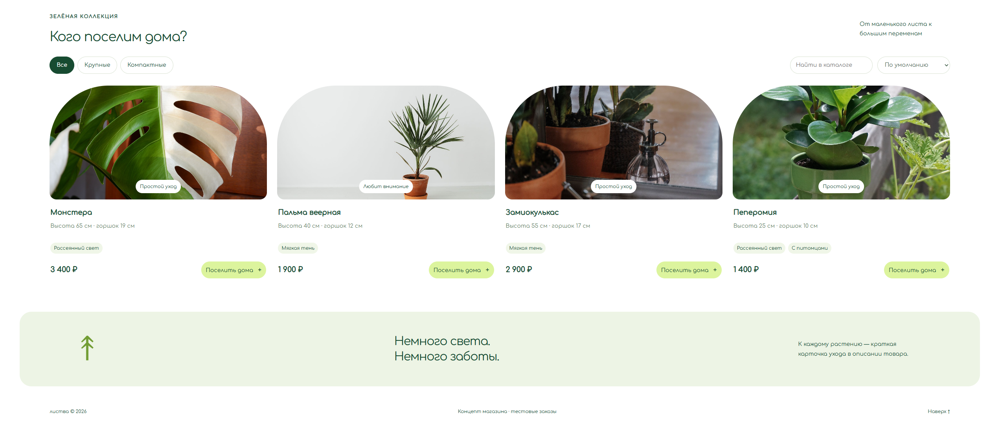

# ЛИСТВА

Интернет-магазин домашних растений с каталогом, корзиной, оформлением тестовых заказов и подбором растений под условия конкретного дома.

Проект сделан как самостоятельный портфолио-кейс с клиентской частью, серверным API и локальной базой данных.

## О проекте

«ЛИСТВА» — концепт магазина домашних растений.

Основная идея проекта — помочь пользователю не просто выбрать растение по внешнему виду, а подобрать вариант, который действительно подходит под условия дома.

Для этого в магазине есть отдельный подбор по трём параметрам: количеству света, готовности ухаживать за растением и наличию домашних животных.

## Превью

### Десктоп




### Мобильная версия


## Возможности

- каталог домашних растений;
- категории товаров;
- поиск по каталогу;
- сортировка по цене;
- подробная карточка растения;
- подбор растений по условиям дома;
- учёт количества света;
- выбор уровня ухода;
- фильтрация растений, подходящих для дома с питомцами;
- корзина с изменением количества товаров;
- сохранение корзины в `localStorage`;
- оформление тестового заказа;
- серверная проверка цены и доступных остатков;
- учёт остатков товаров;
- бесплатная доставка от заданной суммы;
- адаптивный интерфейс;
- резервный статический режим при недоступном API.

## Подбор растений

В разделе «Подобрать своё» пользователь отвечает на три вопроса:

- сколько света в помещении;
- сколько времени он готов уделять уходу;
- есть ли дома питомец.

После этого каталог показывает растения, подходящие под выбранные условия.

Подбор работает на основе характеристик каждого растения в каталоге.

## Технологии

### Frontend

- React 19
- TypeScript
- CSS

### Backend

- Node.js
- Node HTTP Server
- SQLite

### Сборка и инструменты

- esbuild
- TypeScript Compiler
- Docker
- GitHub Actions
- Node Test Runner

## API

Проект содержит собственный серверный API.

Основные маршруты:

```text
GET  /api/health
GET  /api/catalog
POST /api/orders
GET  /api/orders/:id
```

При оформлении заказа сервер повторно рассчитывает стоимость, проверяет остатки и сохраняет тестовый заказ в SQLite.

## Локальный запуск

Для запуска требуется Node.js 24 или новее.

Клонировать репозиторий:

```bash
git clone https://github.com/wakukiku/listva.git
cd listva
```

Установить зависимости:

```bash
npm install
```

Запустить проект:

```bash
npm run dev
```

По умолчанию приложение запускается по адресу:

```text
http://localhost:3000
```

## Production-сборка

Собрать проект:

```bash
npm run build
```

Запустить собранную версию:

```bash
npm start
```

## Проверка типов

```bash
npm run check
```

## Тесты

```bash
npm test
```

Тестами покрыты:

- логика подбора растений;
- совместная работа параметров света, ухода и питомцев;
- серверный расчёт стоимости заказа;
- проверка остатков;
- защита от повторного создания одного заказа;
- изоляция заказов по пользовательским сессиям;
- сохранность данных SQLite.

## Переменные окружения

Пример конфигурации находится в `.env.example`.

```env
PORT=3000
HOST=127.0.0.1
DB_PATH=./data/store.sqlite
```

## Docker

В проекте есть `Dockerfile`.

Пример запуска:

```bash
docker build -t listva .
docker run -p 3000:3000 listva
```

## Статус

Проект завершён как портфолио-кейс.

Оформление заказа работает в демонстрационном режиме. Реальная оплата и доставка не выполняются.

---

**ЛИСТВА** — портфолио-проект интернет-магазина домашних растений.
